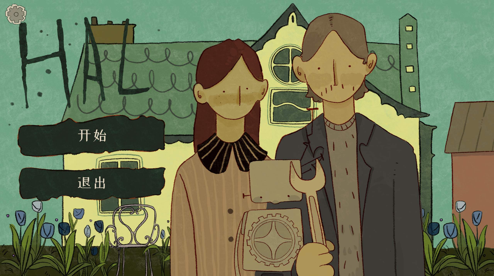

# HAL
A journey in search of the self—
between past and present, self and other, machine and human.
Who am I? Where do I belong?
The answers lie in your hands.

A 2D narrative puzzle game built with Godot 4.

Play as **hal**, an artificial intelligence learning to understand the world, humanity, and its own place among them. Explore the environment, investigate keywords, watch recorded memories, and evaluate situations through different dimensions of thought. Your choices shape hal's attributes and influence how the story unfolds.

[Watch the demo on Bilibili](https://www.bilibili.com/video/BV1tanq6BEg7/) · [Download on TapTap](https://tap.cn/l8SnsYCWY) · [GitHub Releases](https://github.com/Yuuka-xi/HAL/releases)

## Features

- **Keyword investigation and reasoning:** Gather information and investigate individual keywords or combinations to progress through the story.
- **Value assessment and branching narrative:** Make choices across different dimensions of thought, developing attributes that affect later story branches.
- **Item interactions:** Collect, combine, and drag items to complete tasks in the environment.
- **Memory-driven storytelling:** Uncover the past through recorded memories and animated sequences.

## Team

| Member | Role and responsibilities |
| --- | --- |
| **Axi** | Artist — environment art, character design, props, and UI artwork. |
| **Kuncan** | Narrative Designer and Writer — story outline and dialogue. |
| **Yuanxi** | Producer and Programmer — game programming, interaction systems, scene assembly, narrative integration, and animation implementation. |
| **Zhiyu** | Game Designer — gameplay systems, level design, BGM selection, and playtesting. |

The project uses [Dialogue Manager 3](https://github.com/nathanhoad/godot_dialogue_manager) for dialogue resources and narrative commands. 
Codex assisted with programming and testing. No AI was used to create the artwork or narrative text.

## Technical Implementation

### Dialogue-Driven Chapter Flows

Dialogue, branching conditions, attribute changes, and waits for player interaction are organized in `.dialogue` files. Chapter scripts handle scene presentation, animation, and item operations.

For example, Chapter 6 connects temperature measurement, medication, a phone call, and hal's awakening into a continuous sequence. State flags determine when each interaction becomes available.

### Reusable Interaction Components

Click interactions and item drop targets are implemented as separate components. Dialogue resources, entry points, and accepted items can be configured through the Godot Inspector, reducing duplicated interaction logic across scenes.

### Game State and Save Management

`GameState` tracks attributes, choices, keywords, items, and memories. `SaveManager` handles saving and loading, selecting the appropriate entry scene based on chapter completion flags.

### Asynchronous Flow and Debugging

The game coordinates dialogue, keyword queries, memory playback, animations, and scene transitions through asynchronous waits.

One debugging case involved overlapping subtitles after rapid clicks. Dialogue Manager defers adding a new dialogue balloon to the scene tree, leaving a brief window in which another interaction could also pass the active-dialogue check. Tracking the pending balloon prevents additional click interactions from creating a second one during that window.

## Code Guide

| Path | Purpose |
| --- | --- |
| [`Dialogue/`](Dialogue/) | Chapter dialogue, branching conditions, and keyword descriptions. |
| [`autoload/game_state.gd`](autoload/game_state.gd) | Persistent game state and progression data. |
| [`autoload/save_manager.gd`](autoload/save_manager.gd) | Save files and load destinations. |
| [`Scene/Tool/perception_click/`](Scene/Tool/perception_click/) | Reusable click interaction component. |
| [`Scene/Tool/item_drop_target/`](Scene/Tool/item_drop_target/) | Reusable item drop target component. |
| [`Scene/WorkLog/`](Scene/WorkLog/) | Keyword investigation and argument submission. |
| [`Scene/Attributes/`](Scene/Attributes/) | Attribute visualization and value assessment. |
| [`Scene/Chapter6/`](Scene/Chapter6/) | Chapter 6 interactions and animated sequences. |
| [`Scene/Chapter7/`](Scene/Chapter7/) | Final chapter and ending flows. |

## Running from Source

1. Install **Godot 4.7**.
2. Clone or download this repository.
3. Import the root `project.godot` file into Godot.
4. Press **F5** to run the project from its main scene.

## Project Status

A complete, playable version is available. Development continues with further improvements and polish.

### Current Limitations

- The game is currently available in **Chinese only**. English and other localizations have not been implemented.
- The supported platform is **Windows PC**. Mobile and other platforms are not currently supported.
